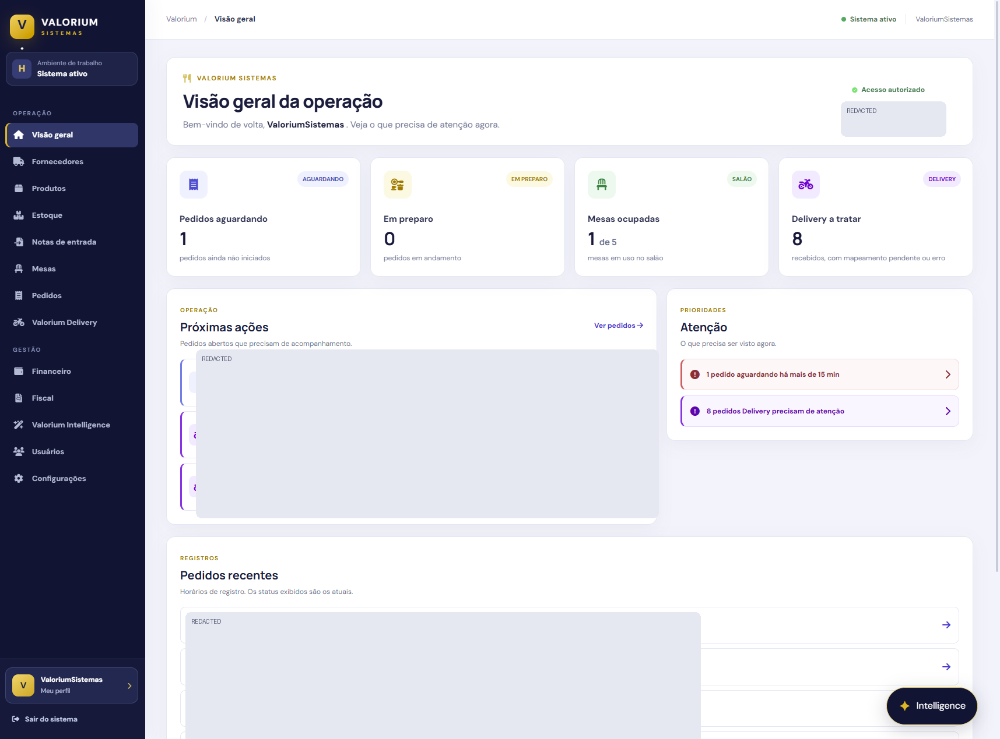
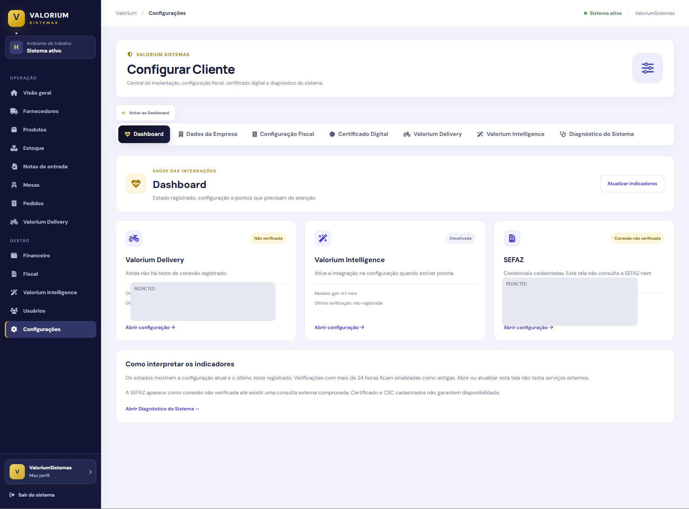
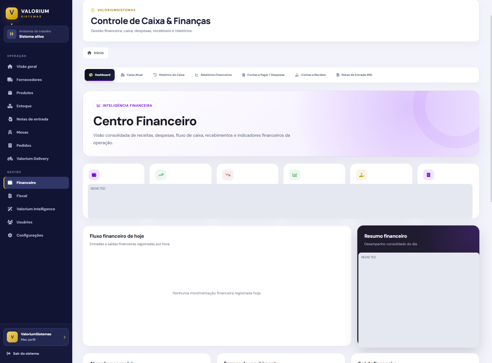
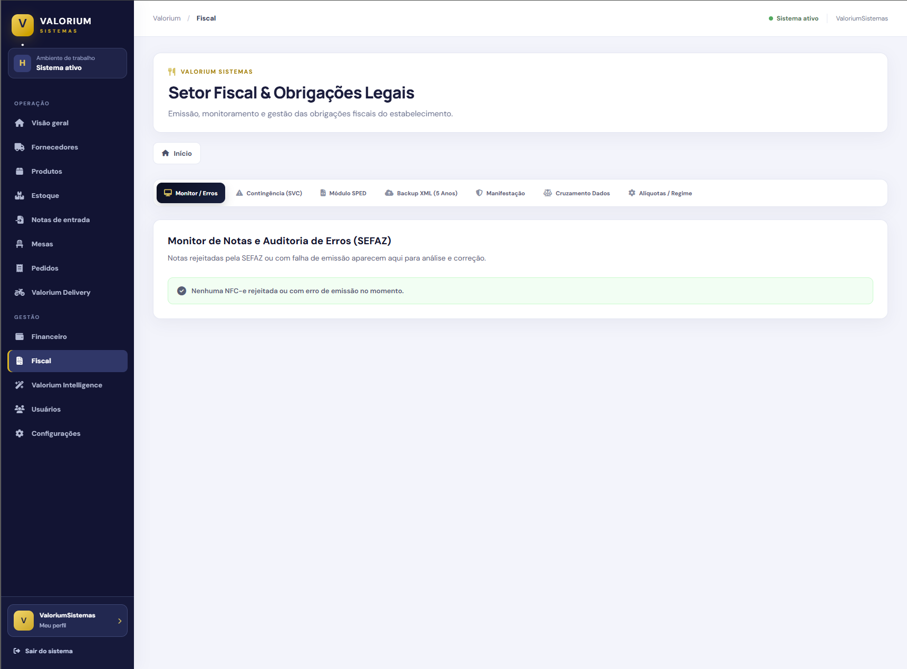
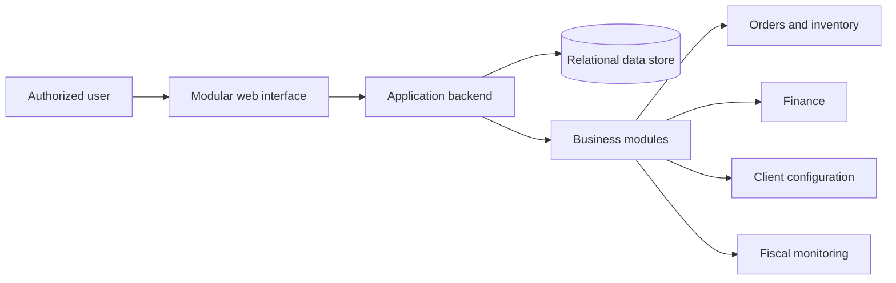

# Valorium Sistemas

### Modular Business Management Platform — Engineering Showcase

**PHP · JavaScript · HTML · CSS · SQL · Business Workflows**

A technical case study of a modular business management platform developed within the Valorium software ecosystem.

[Application Preview](#application-preview) · [Architecture](#conceptual-architecture) · [Engineering Focus](#engineering-focus) · [Security](docs/security.md)

---

## Overview

Valorium Sistemas is a business software initiative that brings together operational and administrative workflows through a modular web interface. The visible application includes dashboards for operational monitoring, finance, fiscal monitoring and customer configuration.

This repository is a **documentation-only engineering showcase**, not the production codebase, a downloadable application or evidence of regulatory certification.

## Application Preview

### Operational overview

*Actual interface screenshot with operational identifiers and sensitive activity information redacted. Shows order monitoring, operational priorities and module navigation.*

### Client configuration and integration health

*Actual interface screenshot with internal configuration details redacted. Integration status labels are interface indicators, not proof of successful external connectivity.*

### Financial management

*Actual interface screenshot with financial figures redacted. Illustrates the design of cash-management, reporting and financial overview screens.*

### Fiscal monitoring

*Actual interface screenshot of the fiscal monitoring module. This does not establish that tax document issuance or external tax authority integration has been certified or tested.*

## Technology Stack

| Layer | Technologies / concepts |
| --- | --- |
| Web interface | HTML, CSS, JavaScript |
| Application backend | PHP |
| Data | SQL and relational data workflows |
| Architecture | Modular business application, administrative workflows |
| Operations | Orders, inventory, finance, fiscal monitoring, client configuration |
| Integration considerations | Cross-module data consistency, authorization, external service diagnostics |

## Conceptual Architecture

*Conceptual diagram only. Exact internal endpoints, data models, hosting topology and security controls are intentionally omitted.*

Read more in [Architecture](docs/architecture.md) and [Module Workflows](docs/module-workflows.md).

## Engineering Focus

- Designing cohesive interfaces for distinct business domains within one platform.
- Organizing modules for operational monitoring, finance, configuration and fiscal workflows.
- Considering role-based access, authorization boundaries and safe administrative operations.
- Coordinating state, navigation and data presentation across business modules.
- Separating external integration status from verified connectivity or regulatory compliance.
- Preserving confidential implementation details while communicating engineering decisions.

These points describe the project's engineering scope; not every planned integration or feature has been independently verified as production-ready.

## My Role

**Guilherme Langkammer — Founder & Software Developer, Valorium Sistemas.** Project planning, web application development, modular UI design, systems integration design and troubleshooting.

## Contact

- [GitHub](https://github.com/Guilherme-Langkammer)
- [LinkedIn](https://www.linkedin.com/in/guilherme-de-paula-langkammer-1a64b0344/)
- Email: guilhermelangkammer008@gmail.com

## Notice

This is a public engineering case study. Production source code, internal configurations, credentials, customer records, deployment details and business data remain private. No license to use proprietary software is granted by this showcase.
